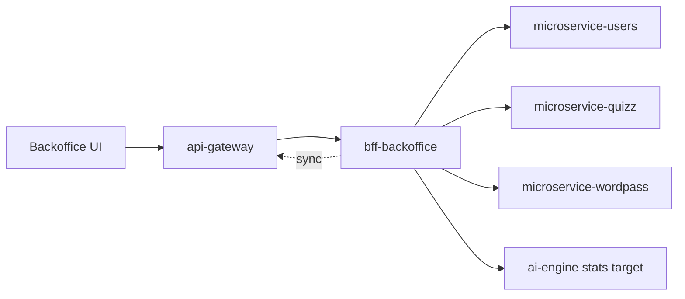

# bff-backoffice

Last updated: 2026-05-08.

Backend-for-Frontend service for AxiomNode backoffice operations.

## Responsibility

`bff-backoffice` is the operational control plane for the backoffice channel. It shields the UI from domain-service details and exposes one narrow runtime control: pointing the ai-engine llama target at another host.

## Runtime role

### Runtime context

### Main responsibilities

- Expose admin-focused APIs for monitoring and control workflows.
- Aggregate and normalize data from internal services.
- Keep backoffice UI decoupled from domain-service internals.
- Let operators read, probe, set and reset the ai-engine llama target.

## Runtime surface

### Control-plane role

`bff-backoffice` is more than a read-only BFF: it also exposes a narrow control for the ai-engine llama target. The BFF keeps no routing state of its own; the target is persisted by `ai-engine` (`/internal/admin/llama-target`) and every change is recorded in the audit trail.

### Role-facing admin routes

`bff-backoffice` proxies the user-role management surface from `microservice-users` for Backoffice consumers:

- `GET /v1/backoffice/admin/users/roles`: readable by `SuperAdmin` and `Inspector` after downstream auth validation.
- `PATCH /v1/backoffice/admin/users/roles/:firebaseUid`: mutation remains restricted to `SuperAdmin` downstream.

The BFF does not own the role enum. Canonical role values are defined in `contracts-and-schemas` and enforced by `microservice-users`.

Operator-facing diagnostics semantics and runtime-control behavior are documented in the capability dossiers so this README can stay focused on repository ownership.

## Local setup

### Repository structure

- `src/`: Fastify + TypeScript implementation.
- `docs/`: architecture, guides, and operations docs.
- `.github/workflows/ci.yml`: CI + deployment dispatch trigger.

### Primary operational use cases

- inspect service health and operational summaries
- read, probe, set and reset the ai-engine llama target

### Local development

1. `cd src`
2. `cp .env.example .env`
3. `npm install`
4. `npm run dev`

### Route note

This service owns backoffice-facing diagnostics, the ai-engine target routes (`GET/PUT/DELETE /v1/backoffice/ai-engine/target`, `POST /v1/backoffice/ai-engine/probe`) and the ai-engine plugin capabilities readback. Use `docs/architecture/README.md` and the operations capability dossiers for the concrete inventory.

### Runtime state model

- The BFF holds no persisted routing state. Upstream service URLs always come from the environment variables below.
- The llama target override lives in `ai-engine` (`AI_ENGINE_LLAMA_TARGET_STATE_FILE`), not here.

## Dependencies and contracts

### Dependency model

Primary downstream dependencies:

- `microservice-users`
- `microservice-quizz`
- `microservice-wordpass`
- `ai-engine-stats`
- `api-gateway` administrative synchronization path

## Deployment and operations notes

### CI/CD and rollout note

CI and image publication are documented in `docs/operations/README.md` and `../docs/operations/cicd-workflow-map.md`.

### Internal dependencies

- `USERS_SERVICE_URL`
- `QUIZZ_SERVICE_URL`
- `WORDPASS_SERVICE_URL`
- `AI_ENGINE_STATS_URL`

### Routing and security notes

- Every ai-engine target that is applied (`PUT /v1/backoffice/ai-engine/target`) is checked against `ALLOWED_ROUTING_TARGET_HOSTS` (hostnames, `*.suffix` wildcards, IPv4 CIDRs). Targets must use `http` or `https`.
- Fail closed: when `ALLOWED_ROUTING_TARGET_HOSTS` is empty, target changes are denied unless `NODE_ENV` is `development` or `test` (where the service logs a warning at startup). To point the ai-engine at an external host, add that host to the allowlist.

## Documentation

- `docs/README.md`
- `docs/architecture/README.md`
- `docs/guides/README.md`
- `docs/operations/README.md`

### Failure boundaries

- ai-engine target synchronization failure (the `ai-engine` call fails and the change is reported as 400)
- downstream diagnostics failure while control routes remain available
- allowlist misconfiguration that blocks intended retargeting

## References

- `docs/architecture/`
- `docs/operations/`
- `../docs/guides/capabilities/operations/backoffice-operational-diagnostics.md`
- `../docs/guides/capabilities/operations/runtime-routing-control.md`
- `../docs/operations/runtime-routing-and-service-targeting.md`
